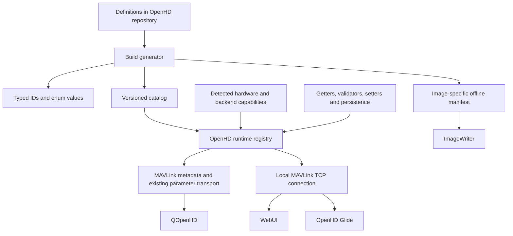

# Proposal: one OpenHD settings contract for every tool

Status: design document, 2026-10-12. The initial implementation integrates OpenHD,
QOpenHD, ImageWriter, WebUI, and Glide. See `OpenHD/settings/README.md` for the
implemented contract, commands, initial configuration, and validation limits.

## Objective

Define shared device settings once in the OpenHD repository. OpenHD publishes the settings and choices supported by the actual device. QOpenHD, WebUI, OpenHD Glide, and ImageWriter consume that contract instead of maintaining their own parameter descriptions, numeric enums, platform checks, and storage mappings.

“Automatically synced” means synchronized definitions, available choices, and observed values. It does not mean copying configuration between Air and Ground, cameras, or devices without an explicit operation.

## Current evidence

- `OpenHD/ohd_common/inc/openhd_settings_imp.h`: `Setting` contains an ID and an integer/string value with setter/getter callbacks. It lacks descriptive and capability metadata.
- `OpenHD/ohd_video/src/camera_holder.cpp`: `get_all_settings()` already conditionally registers camera parameters based on camera type/platform. Extend this foundation rather than building a disconnected availability database.
- `QOpenHD/app/telemetry/settings/documentedparam.cpp`: descriptions, enum mappings, and ranges live in a separate client table.
- `QOpenHD/app/telemetry/settings/mavlinksettingsmodel.cpp`: `get_ui_metadata()` derives controls from that client table; this provides an integration point for device metadata.
- ImageWriter's `doc/openhd_settings_map.json` and `src/configure.qml` describe boot-file outputs and platform/camera choices separately.
- WebUI's `HotspotSettingsService.cs` has a direct networking-settings file path, while its camera service delegates to SysUtils. Migration must cover both runtime parameters and setup/service settings.
- Glide lives in `C:/Users/Raphael/openhd-glide`; its MAVLink bridge and LVGL UI now consume the resolved registry.

## Architecture



Use declarative definitions in `OpenHD/settings/` as the authoring source. Generate C++ IDs/enums, JSON catalogs, and boot-config artifacts. Prefer JSON plus a JSON Schema initially to avoid another parser dependency. Split definitions by module for ownership, but validate and export one contract.

Bind generated definitions to actual backend implementations through typed registration. Runtime registry entries carry metadata and the real getter, validator, setter, and capability provider. A setting cannot become writable merely because it exists in the catalog.

For SysUtils-owned settings, keep shared definitions in this contract and bind them through a SysUtils adapter. This allows setup settings to function before the OpenHD daemon starts. OpenHD-owned storage and boot mappings are generated or interpreted by the owner; clients do not independently recreate them.

Application-only preferences such as QOpenHD HUD layout remain owned by that application. They can use the same schema and renderer, with a separate namespace and provider.

## Definition versus device snapshot

Each definition includes:

| Field | Purpose |
|---|---|
| Stable semantic ID | Identity such as `camera.video.format`; never a translated label |
| Legacy transport binding | Existing MAVLink parameter ID and component routing |
| Type and constraints | Integer/string/boolean, units, range, step, length, enum wire values |
| Presentation | Label, description, group, order, basic/advanced/developer level, optional control hint |
| Scope and owner | Air/Ground/camera instance; OpenHD/SysUtils/application provider |
| Default policy | Fixed default or an owner-resolved hardware-dependent default |
| Lifecycle | Runtime editable, setup only, first-boot seed, stream restart, or reboot |
| Dependencies | Small declarative dependency vocabulary, evaluated by the owner |
| Persistence | Owner-side storage binding and migrations |
| Capability binding | Typed provider supplying existence, constraints, and available choices |

A device snapshot adds device identity, firmware/build identity, schema major version, boot/session identity, manifest hash, capability generation, resolved constraints/choices, availability, writability, and a reason when disabled. Values travel separately so changing a value does not force a full metadata download.

Setting identity is `(device, component/instance, semantic ID)`. Camera 0 and camera 1 must never share a value cache accidentally.

Example resolved metadata; illustrative rather than an existing endpoint:

```json
{
  "id": "camera.video.format",
  "instance": "camera/0",
  "binding": {"protocol": "mavlink-param-ext", "id": "RESOLUTION_FPS"},
  "type": "string",
  "label": "Video format",
  "group": "camera/video",
  "available": true,
  "writable": true,
  "choices": [
    {"value": "1280x720@60", "label": "720p · 60 fps"},
    {"value": "1920x1080@30", "label": "1080p · 30 fps"}
  ],
  "apply": "stream-restart"
}
```

The choices come from the active capture/encoder combination. Use discrete supported tuples where needed; separate width, height, and FPS ranges can imply invalid combinations. Providers must distinguish detected support from assumptions and restrict editing when support cannot be established.

## Availability rules

1. Firmware/build support establishes whether an implementation exists.
2. Hardware and selected backend establish whether it is supported on this device.
3. Current state establishes whether it is editable now.
4. Dependencies determine resolved choices and constraints.

Unsupported settings are omitted from ordinary device settings pages. Supported but temporarily blocked settings remain visible and disabled with a reason, such as “Stop recording to change this.” Read-only information remains distinguishable from controls. A disconnected device may show its last snapshot as stale, with editing disabled.

Both UI and writes use the same resolved registry. The backend rechecks capabilities, dependencies, and constraints on every write. Hiding a control is not validation.

When camera/backend selection changes, refresh affected metadata and values. A dependent value that becomes invalid requires an explicit policy: reject the parent change, or apply an owner-defined replacement and report it. Do not silently clamp it in a client.

## Delivery and synchronization

Keep existing MAVLink parameter IDs and wire values during migration. Publish standard MAVLink component/parameter metadata for the interoperable subset, and a separately versioned OpenHD extension for dynamic availability, string choices, dependencies, instances, and richer apply semantics.

Deliver metadata over MAVLink FTP so Air metadata is accessible through the existing link. A local MAVLink TCP connection exposes the same registry to WebUI and Glide. All runtime tools use MAVLink; ImageWriter consumes the offline manifest and creates the initial config file.

The standard extended-parameter protocol has no notification that the parameter set changed. Define an OpenHD generation notification and refresh operation. Treat each enumeration as an immutable snapshot; do not change parameter indices/count halfway through it. Legacy clients may retain a session-stable parameter list and rely on write-time rejection until reconnect/re-enumeration.

New clients fetch metadata once, verify its hash, fetch current values, and listen for changes. On reconnect they compare boot identity and capability generation before reusing a cache. Cache keys include device, component, schema version, and manifest hash. Bound metadata sizes, retry transfers, and never treat a partial manifest as complete.

Retain `PARAM_EXT_SET`/ACK for existing writes. Add richer results on the OpenHD API where needed: rejected with reason, accepted/pending, applied, restart required, requested value, and effective value. An ACK alone must not make a client claim that hardware has already applied a pending change. API writes can include an expected generation/revision to detect stale choices and competing clients.

Air/Ground coordinated radio changes belong to an explicit owner operation with sequencing, recovery, and a partial-failure result. They cannot be produced safely by generic automatic value mirroring. Model actions such as scan, reboot, and camera rediscovery separately from persistent settings.

## ImageWriter and first boot

ImageBuilder packages an offline manifest from the same OpenHD commit as the image. Bind it to the image build identity and board profile; do not use the newest online catalog for an older image.

ImageWriter renders only settings declared provisionable for that image/board/role. It cannot know the actual attached camera/radio capabilities before boot. Show target hardware choices as planned configuration, and omit controls that require live probing. Runtime OpenHD validates the plan against detected hardware.

ImageWriter writes a versioned provisioning document containing stable IDs and values. SysUtils/OpenHD imports it through the same owner validation path, reporting rejected entries. Translate legacy boot markers/files through a generated compatibility adapter during migration.

Provisioning seeds missing settings on first boot; it must not overwrite subsequent persistent user choices. Editing an already configured SD card is a separate explicit offline-edit operation, requiring a compatible owner/export format rather than silently repeating provisioning. Maintain backup and migration behavior for existing cards.

## Client behavior

Every client needs a generic settings renderer: toggle, enum selector, number, text, and read-only display. A newly registered ordinary setting then appears without a client release.

Keep tailored radio/camera pages. Those pages reference stable semantic IDs and obtain labels, availability, ranges, and choices from metadata. Hide empty sections and unavailable shortcuts. Adding a setting to a specialized page still requires a layout decision; automatic exposure is guaranteed through the generic page.

Unknown metadata fields in the same major version can be ignored. Unknown types or required semantics are shown read-only with an explanation. For legacy firmware, restrict fallback metadata to parameters actually enumerated and mark capability certainty appropriately; do not treat a missing manifest as permission to show the whole old catalog.

## Incremental implementation

1. Extend `Setting` with descriptors and introduce the contract/generator. Migrate a complete vertical slice: `RESOLUTION_FPS`, one enum setting, and one hardware-specific setting. Preserve old IDs and persistence.
2. Implement resolved registry export, local access, MAVLink metadata delivery, and generation invalidation. Wire validators to shared constraints plus backend checks.
3. Change QOpenHD `get_ui_metadata()` and the generic settings page to prefer device metadata. Validate that specialized sidebar controls obey the same availability.
4. Migrate WebUI and Glide to registry reads/writes; remove shared-setting file writes and duplicated tables once equivalent behavior is proven.
5. Generate release-bound ImageWriter manifests and provisioning import. Migrate camera/board choices and storage mappings with legacy compatibility.
6. Require metadata for all new shared settings; gradually remove legacy client metadata.

CI checks schema validity, duplicate IDs, transport-ID length/uniqueness per component, stable enum values, valid defaults, backend bindings, generated-file consistency, and image/catalog build matching. Capability tests cover Pi legacy/libcamera, Rockchip, USB/IP camera, Air/Ground, absent radios, and dependency changes.

Acceptance: a test firmware adds one setting in OpenHD and binds its implementation; unchanged clients discover and edit it on supported hardware, omit it on unsupported hardware, refresh after capability changes, and report rejected/stale writes. ImageWriter consumes its matching manifest without another hand-maintained setting entry. Validate this on actual supported devices before claiming hardware correctness.

## Protocol references

- [MAVLink component metadata](https://mavlink.io/en/services/component_metadata.html): discovery and metadata delivery.
- [MAVLink extended parameters](https://mavlink.io/en/services/parameter_ext.html): existing value transport, ACK semantics, and parameter-set synchronization limitations.
